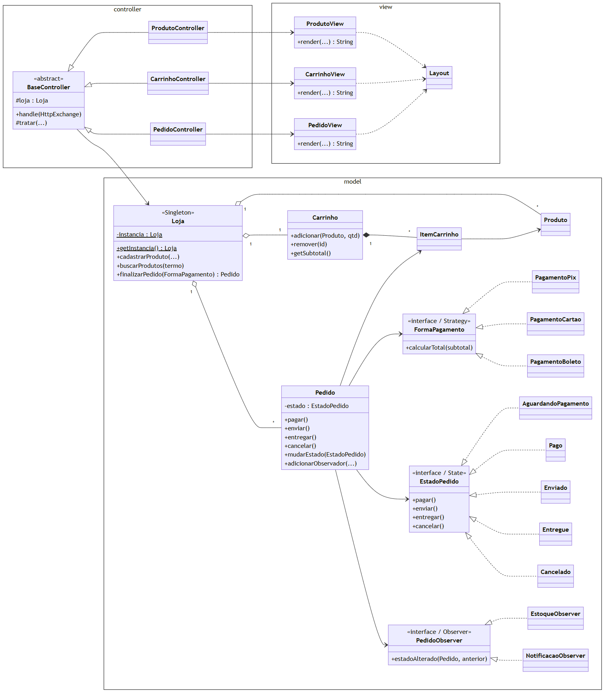

# Livraria A3 — E-commerce em Java (MVC + Design Patterns)

Aplicação web de e-commerce de uma livraria, desenvolvida em **Java puro** para a avaliação A3 de Engenharia e Arquitetura de Software. Usa arquitetura **MVC** e os padrões **Singleton, Strategy, State e Observer**.

**Autor:** Gustavo Andrade

## Requisitos

- **Java 17 ou superior** (JDK, com `javac`). Testado com Java 25.
- Nenhuma biblioteca externa: o servidor web é o `com.sun.net.httpserver`, que já vem no JDK.

## Como executar

**Windows:**

```bat
executar.bat
```

**Linux/macOS:**

```sh
sh executar.sh
```

**Manualmente (PowerShell):**

```powershell
javac -encoding UTF-8 -d out (Get-ChildItem -Recurse src -Filter *.java).FullName
java -cp out loja.Main
```

**Manualmente (Linux/macOS):**

```sh
javac -encoding UTF-8 -d out $(find src -name "*.java")
java -cp out loja.Main
```

Depois abra **http://localhost:8080** no navegador. Para usar outra porta: `java -cp out loja.Main 9090`.

Os dados ficam em memória: ao reiniciar o programa, a loja volta aos 3 livros iniciais.

## Funcionalidades

| Funcionalidade | Onde |
|---|---|
| Cadastro de produtos (nome, preço, estoque) | Tela **Produtos** |
| Consulta de produtos (listagem e busca por nome) | Tela **Produtos** |
| Inclusão de itens no carrinho (com quantidade) | Tela **Produtos** → botão *Adicionar* |
| Remoção de itens do carrinho | Tela **Carrinho** → botão *Remover* |
| Cálculo do valor da compra (subtotal e total por forma de pagamento) | Tela **Carrinho** |
| Finalização do pedido (baixa o estoque e esvazia o carrinho) | Tela **Carrinho** → *Finalizar pedido* |
| Acompanhamento do estado do pedido (pagar, enviar, entregar, cancelar) e notificações | Tela **Pedidos** |

### Validações e tratamento de erros

- Campos obrigatórios (nome, preço, estoque, forma de pagamento).
- Preço deve ser numérico e maior que zero; estoque e quantidade devem ser inteiros (quantidade > 0).
- Não permite produto com nome repetido.
- Não permite adicionar ao carrinho mais unidades do que há em estoque.
- Não permite finalizar com o carrinho vazio.
- Ações incompatíveis com o estado do pedido são bloqueadas (ex.: entregar um pedido não pago, cancelar um pedido já enviado, pagar um pedido cancelado).
- Textos digitados pelo usuário são escapados antes de aparecer no HTML.

As mensagens de erro aparecem em vermelho no topo da tela; as de sucesso, em verde.

## Arquitetura MVC

```
src/loja/
├── Main.java                  # inicia o servidor e liga as rotas aos controllers
├── model/                     # MODEL: dados, regras de negócio e estados
│   ├── Loja.java              #   Singleton com produtos, carrinho e pedidos
│   ├── Produto.java, Carrinho.java, ItemCarrinho.java, Pedido.java
│   ├── pagamento/             #   Strategy: FormaPagamento, PagamentoPix, PagamentoCartao, PagamentoBoleto
│   ├── estado/                #   State: EstadoPedido, AguardandoPagamento, Pago, Enviado, Entregue, Cancelado
│   └── observer/              #   Observer: PedidoObserver, EstoqueObserver, NotificacaoObserver
├── view/                      # VIEW: gera o HTML das telas
│   ├── Layout.java, ProdutoView.java, CarrinhoView.java, PedidoView.java
└── controller/                # CONTROLLER: recebe as ações da tela e aciona o Model
    ├── BaseController.java, ProdutoController.java, CarrinhoController.java, PedidoController.java
```

- **Model** não conhece HTML nem HTTP; contém todas as regras (estoque, totais, transições de estado).
- **View** só recebe objetos do Model e devolve HTML; não altera dados.
- **Controller** lê os parâmetros da requisição, valida o formato, chama o Model e escolhe qual View exibir (ou redireciona com uma mensagem).

## Padrões de projeto

| Padrão | Classes | Problema resolvido |
|---|---|---|
| **Singleton** | `model/Loja` | Os três controllers precisam enxergar os **mesmos** produtos, carrinho e pedidos em memória. O construtor é privado e o acesso é só por `Loja.getInstancia()`. |
| **Strategy** | `FormaPagamento` (interface), `PagamentoPix`, `PagamentoCartao`, `PagamentoBoleto` | Cada forma de pagamento calcula o total de um jeito (Pix: −10%; Cartão: integral; Boleto: +R$ 3,00). O `Pedido` usa a estratégia escolhida sem `if/else`; nova forma de pagamento = nova classe. |
| **State** | `EstadoPedido` (interface), `AguardandoPagamento`, `Pago`, `Enviado`, `Entregue`, `Cancelado`; contexto: `Pedido` | O pedido muda de comportamento conforme o estado. Cada estado libera só as transições válidas; as demais lançam erro (ex.: não dá para entregar antes de pagar). |
| **Observer** | `PedidoObserver` (interface), `EstoqueObserver`, `NotificacaoObserver`; sujeito: `Pedido` | Quando um pedido muda de estado, outras partes reagem sem que o `Pedido` as conheça: `EstoqueObserver` devolve os itens ao estoque no cancelamento e `NotificacaoObserver` registra a notificação exibida na tela de Pedidos. |

### Diagrama de classes



O código-fonte do diagrama (Mermaid) está em [`docs/diagrama-classes.mmd`](docs/diagrama-classes.mmd).

### Ciclo de estados do pedido

```
Aguardando pagamento --pagar--> Pago --enviar--> Enviado --entregar--> Entregue
        |                        |
        +--------cancelar--------+--> Cancelado  (estoque devolvido)
```

## Testes

O arquivo [`tests/fluxo-completo.js`](tests/fluxo-completo.js) é um teste de ponta a ponta com **Playwright** que percorre todo o fluxo pelo navegador (35 verificações): cadastro e busca de produtos, validações, carrinho, totais de cada forma de pagamento, finalização, todas as transições de estado, transições proibidas, devolução de estoque no cancelamento e notificações.

Para rodar (requer Node.js):

1. Inicie a aplicação com dados recém-carregados (`executar.bat` ou `sh executar.sh`).
2. Em outro terminal, na pasta do projeto:

```sh
npm install playwright
npx playwright install chromium
node tests/executar-teste.js
```

O resultado lista cada verificação como `PASS` ou `FAIL` e termina com o total (ex.: `35/35 passaram`).

## Documentação

- [`docs/Resumo.pdf`](docs/Resumo.pdf) — resumo do desenvolvimento com o diagrama de classes.
